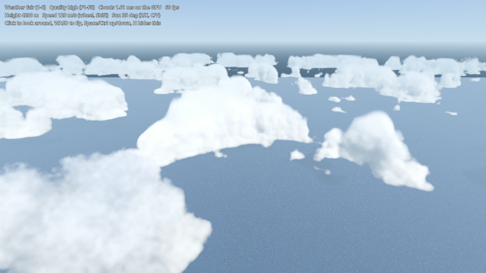
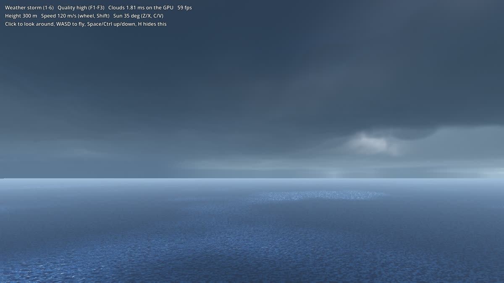
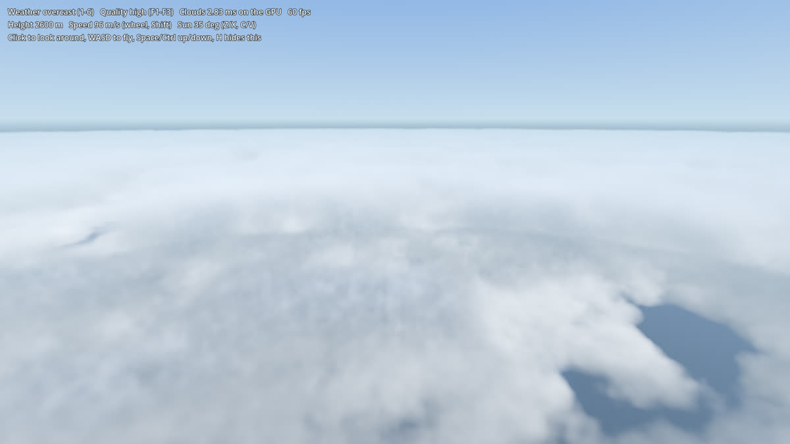

# Godot 4 體積雲範例（Godot Volumetric Clouds）

用 Godot 4 的 **Compositor 運算著色器**做的光線步進體積雲：半解析度步進、依深度合成、混入前一幀降噪，附天氣與畫質預設。打開就能在雲裡飛。

Ray-marched volumetric clouds for Godot 4 as a **CompositorEffect** (compute shaders): marched at a fraction of the screen's size, composited with a depth test, temporally smoothed, with weather and quality presets. Open the project and fly through the clouds.



| 暴風雨 Storm | 陰天雲海 Overcast from above |
|---|---|
|  |  |

這個範例來自我的空戰遊戲專案，完整的開發過程寫在部落格：[從零做出空戰遊戲的體積雲：Godot 4 實作與效能調校](https://dev-mojo.blogspot.com/2026/11/godot-4.html)。

## 需求 Requirements

- Godot **4.4 以上**（開發時用 4.7.1）。
- 渲染器要用 **Forward+** 或 **Mobile**（需要運算著色器）。Compatibility 不支援。

## 操作 Controls

| 按鍵 | 功能 |
|---|---|
| 滑鼠左鍵／Esc | 抓住滑鼠開始轉視角／放開滑鼠 |
| W A S D | 飛行；Space／Ctrl 上升／下降；Shift 加速；滾輪調速度 |
| 1 – 6 | 天氣：晴、少雲、多雲、陣雨、陰天、暴風雨 |
| F1 F2 F3 | 畫質：低、中、高 |
| Z／X、C／V | 太陽降低／升高、太陽往左／往右轉 |
| H | 隱藏說明 |

左上角會顯示雲每幀花的 GPU 時間（用時間戳記量）。

命令列（加在 `--` 之後）：`--weather=storm --quality=low --height=1500 --pitch=-20 --shot=4 --quit=5`

## 用在自己的專案 Using it in your project

把 `clouds/` 資料夾複製過去，然後：

```gdscript
var clouds := VolumetricClouds.new()
clouds.world_environment = $WorldEnvironment   # 會把效果加進它的 compositor
clouds.sun = $DirectionalLight3D
add_child(clouds)

clouds.apply_weather("storm")    # clear / fair / cloudy / showers / overcast / storm
clouds.apply_quality("medium")   # low / medium / high
clouds.coverage = 0.7            # 也可以直接調每個參數
```

雲層的高度（`cloud_base`、`cloud_top`）以 y = 0 為海平面，單位是公尺。`ambient_top`、`ambient_bottom`、`haze` 請設成你場景的天空色、地面或海面色、地平線霧色，雲才會融入場景。

## 檔案 Files

| 檔案 | 內容 |
|---|---|
| `clouds/volumetric_clouds.gd` | 對外的節點：產生雜訊、天氣與畫質預設、每幀把參數交給運算著色器、全螢幕面 |
| `clouds/clouds_effect.gd` | `CompositorEffect`：建立 shader、貼圖、uniform，派送兩個運算著色器，GPU 計時 |
| `clouds/clouds_march.glsl` | 光線步進：天氣圖、高度輪廓、3D 雜訊、Beer-Lambert、雙瓣相位函數、多重散射近似、雲底下的雨幕 |
| `clouds/clouds_composite.glsl` | 放大、混入前一幀（依畫面位移減少殘影）、依深度挖掉前景物件 |
| `clouds/clouds_show.gdshader` | 把結果貼到畫面上；排在半透明物件中最先畫，所以煙、粒子會畫在雲上面 |
| `demo/` | 範例場景：天空、太陽、帶雲影的海面、自由飛行鏡頭 |

## 做法摘要 How it works

1. **密度**：一張可無縫重複的 2D 天氣圖（約 36 km）決定哪裡有雲；雲種的高度輪廓（層雲到積雲）決定雲在高度上的形狀；低頻 Perlin 雜訊被 Worley 雜訊侵蝕出雲的主體，再用高頻雜訊磨出邊緣。雜訊都用 `NoiseTexture3D` 在開場產生。
2. **光照**：每個取樣點朝太陽再取 4 到 5 點算遮蔽（Beer-Lambert），雙瓣 Henyey-Greenstein 相位函數，三層八度的多重散射近似，上方天空色、下方地面色的環境光。不透明度用 `1 − exp(−σ·Δs)`，步長改變時外觀不變。
3. **步進**：步長隨距離加長；每個像素的起點錯開一整個第一步，每幀再加黃金比例遞增，避免看到一層層的切片。
4. **半解析度**：步進只算 1/4 到 1/16 的像素，同時記下雲從多遠開始；合成時若前景物件比那個距離還近，就把雲挖掉，所以物件邊緣仍是全解析度。
5. **前一幀混合**：鏡頭轉得快或雲在畫面上移動超過約一個像素時，就減少混入前一幀，避免殘影。

## 畫質與效能 Quality and cost

RTX 3060、1600×900、不鎖幀下，雲的平均 GPU 時間：

| 畫質 | 運算解析度 | 步數／光照步數 | 雲平均 | 雲最差情況 |
|---|---|---|---|---|
| 低 | 1/4 | 48／4 | 0.23 ms | 0.5 ms |
| 中 | 1/3 | 48／5 | 0.32 ms | 0.7 ms |
| 高 | 1/2 | 72／5 | 0.72 ms | 1.9 ms |

開著垂直同步時 GPU 會降頻，左上角顯示的時間會偏高，比較時請用 `--disable-vsync` 執行。

## 參考資料 References

- Andrew Schneider, [The Real-Time Volumetric Cloudscapes of Horizon Zero Dawn](https://www.guerrilla-games.com/read/the-real-time-volumetric-cloudscapes-of-horizon-zero-dawn), SIGGRAPH 2015.
- Andrew Schneider, [Nubis: Authoring Real-Time Volumetric Cloudscapes with the Decima Engine](https://www.guerrilla-games.com/read/nubis-authoring-real-time-volumetric-cloudscapes-with-the-decima-engine), SIGGRAPH 2017.
- Sébastien Hillaire, [Physically Based Sky, Atmosphere and Cloud Rendering in Frostbite](https://media.contentapi.ea.com/content/dam/eacom/frostbite/files/s2016_pbs_frostbite_sky_clouds.pdf), SIGGRAPH 2016.
- Martin Roberts, [The Unreasonable Effectiveness of Quasirandom Sequences](https://extremelearning.com.au/unreasonable-effectiveness-of-quasirandom-sequences/).
- Godot docs: [The Compositor](https://docs.godotengine.org/en/stable/tutorials/rendering/compositor.html), [Texture2DRD](https://docs.godotengine.org/en/stable/classes/class_texture2drd.html).

## 授權 License

MIT，見 [LICENSE](LICENSE)。
